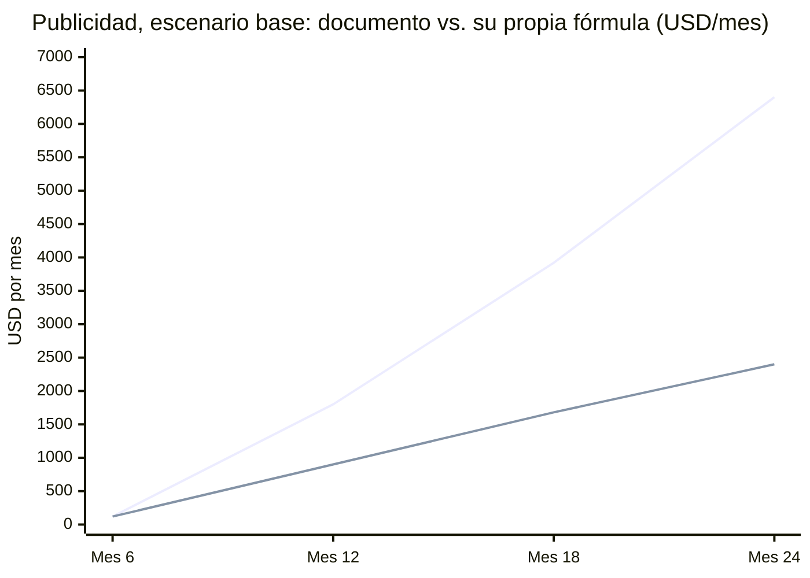

# BUSSY — Revisión crítica y verificación de datos

13 de octubre de 2026

## Veredicto

El problema es real y un piloto pequeño es viable, pero varios datos base están mal, el modelo financiero infla la publicidad entre 2 y 2.7 veces, y el MVP choca con la ley de tránsito y con los incentivos del propio conductor. Revisé los 9 documentos y la presentación del repo, y contrasté las cifras con fuentes abiertas.

Las cinco correcciones que más cambian el plan:

1. **Managua no es una economía de efectivo sin infraestructura.** Los buses urbanos usan la tarjeta TUC de MPeso desde 2013, con validadores en toda la flota de entonces (834 buses). Ese sistema ya registra abordajes por bus y hora: es socio, competidor o fuente de datos, y ningún documento lo menciona.
2. **La flota de "1,100 buses en Managua" es un número nacional.** 1,100 era el acumulado de buses Yutong a agosto 2024, repartido entre Managua, Masaya y Chinandega; a marzo 2026 ya son 2,180 en todo el país. La flota urbana de Managua era de 835 buses en 2016. Falta el dato actual de Managua.
3. **Con tus propios supuestos, el ingreso por anuncios está inflado.** DAU × 5 impresiones × eCPM da la mitad o menos de lo que muestran las tablas desde el mes 12. Corregido, el escenario base termina el mes 24 con un acumulado cercano a −$25K, no +$5.6K.
4. **El conductor no puede manipular la app mientras maneja.** La Ley 431 (art. 25, inciso 24) clasifica conducir usando manualmente el teléfono como infracción de mayor peligrosidad. Los botones de ocupación para el conductor quedan fuera.
5. **Trufi Core es GPL-3.0, no MIT.** Usarla como base de la app obliga a publicar tu código bajo la misma licencia.

Además, la presentación (agosto 2026) contradice a los documentos: propone que solo los pasajeros transmitan ("Estoy a bordo"), con Firebase y login de Google, mientras los planes dicen que el conductor es el usuario #1, con Supabase y SMS. Hay que elegir un modelo antes de construir.

## Verificación de datos

De 22 afirmaciones revisadas, 6 se sostienen, 12 están mal, incompletas o desactualizadas, y 4 no tienen fuente verificable o son dudosas. Las "No verificada" no son necesariamente falsas: son cifras que no deberían ir a una presentación sin fuente.

| Afirmación en el repo | Qué dicen las fuentes | Estado |
| --- | --- | --- |
| "Todo funciona en cash, no hay infraestructura digital" | Tarjeta TUC de MPeso desde 2013, validadores en los 834 buses urbanos de entonces ([MPeso](https://bafybeiemxf5abjwjbikoz4mc3a3dla6ual3jsgpdr4cjr3oz3evfyavhwq.ipfs.4everland.io/wiki/MPeso.html)) | Incorrecta |
| ~1,100 buses activos en Managua | 1,100 era el acumulado Yutong de ago-2024 para Managua, Masaya y Chinandega ([Summa](https://revistasumma.com/nicaragua-entrega-100-autobuses-chinos-para-modernizar-el-transporte-urbano-y-suman-1-100)); 2,180 a nivel nacional en mar-2026 ([Global Mass Transit](https://globalmasstransit.net/managua-completes-renewal-of-urban-bus-fleet-2180-new-units-incorporated-into-national-system-nicaragua/)); Managua tenía 835 en 2016 ([La Prensa](https://www.laprensani.com/2017/03/01/nacionales/2190871-no-basta-solo-subsidio-exigir-calidad-transporte-managua)) | Incorrecta |
| "Sin GPS en las unidades"; el gobierno no invierte en rastreo | En 2016 se exigió GPS a ~8,000 buses del país para monitoreo policial y el sector lo ignoró ([La Prensa](https://www.laprensani.com/2016/09/03/nacionales/2094435-buses-transporte-colectivo-no-usan-gps)); los Yutong de 2026 traen cámaras integradas ([El Cronista](https://www.cronista.com/mexico/finanzas-economia/china-suma-un-aliado-clave-en-america-latina-y-le-da-una-flota-de-180-autobuses-tecnologicos-tendran-aire-acondicionado-frenos-abs-y-camaras-de-seguridad/)) | Incompleta |
| Pasaje C$2.50 | Confirmado, subsidiado; sin subsidio costaría al menos C$5 ([La Prensa](https://www.laprensani.com/2017/03/01/nacionales/2190871-no-basta-solo-subsidio-exigir-calidad-transporte-managua)) | Correcta |
| 35–45 rutas | MapaNica documentó 45 líneas en 2016 ([SotM 2016](https://2016.stateofthemap.org/2016/nicaraguas-new-crowd-sourced-bus-map/)) | Correcta |
| 900,000 pasajeros diarios ("datos oficiales IRTRAMMA") | No encontré la fuente. Además son viajes, no personas: con ida y vuelta, las personas únicas serían ~450K, no 630K | No verificada |
| Managua 1.3M hab. (otro doc dice 1.5M+) | 1.38M en el municipio ([CPS](https://cps.es/en/study-of-mobility-and-demand-for-public-transportation-in-managua-nicaragua/)) | Correcta, unificar |
| Internet ~70%, 8.9M conexiones (126%) | 69.6% y 8.89M a fines de 2025 ([DataReportal 2026](https://datareportal.com/reports/digital-2026-nicaragua)). Ojo: penetración nacional ≠ smartphone con datos entre usuarios del bus | Correcta |
| 95%+ del mercado es Android | 80.8% Android, 19.2% iOS en sep-2026 ([StatCounter](https://gs.statcounter.com/os-market-share/mobile/nicaragua)) | Exagerada |
| SMS OTP ~$0.05 | Twilio cobra $0.1856 por SMS a Nicaragua ([Twilio](https://www.twilio.com/en-us/sms/pricing/ni)), 3.7× más | Incorrecta |
| Claude Code Pro ~$200 + Codex Plus ~$200 al mes | Claude Pro cuesta $20 e incluye Claude Code; Max desde $100 ([Claude](https://claude.com/pricing)). ChatGPT Plus $20 con Codex ([eesel](https://eesel.ai/blog/codex-pricing)) | Incorrecta (a tu favor) |
| Mapbox: 50K cargas gratis | Esa cuota es web; en móvil el SDK se factura por usuarios activos mensuales ([Mapbox](https://docs.mapbox.com/android/maps/guides/pricing/)) | Incompleta |
| WhereIsMyTransport: $27M, 50 ciudades, cerró 2023 | Confirmado: más de $27M, 50 ciudades, cerró al no poder levantar otra ronda ([TechCabal](https://techcabal.com/2023/10/26/whereismytransport-shutting-down/)) | Correcta |
| Moovit: 1.3 billones de usuarios, 3,500 ciudades, $915M | Al venderse en 2020: 800M+ usuarios, 3,100 ciudades, ~$900M ([Intel](https://www.intc.com/news-events/press-releases/detail/6/intel-acquires-moovit-to-accelerate-mobileyes)). Revenue de $39M y pérdida de $10M no son públicos | Desactualizada |
| TranSapp es rentable | Sin dato público. Hoy vende marca blanca, app de conductor, editor GTFS y predicción, con clientes de gobierno ([Transapp](https://transapp.cl/en/transapp-celebra-9-anos-impulsando-la-movilidad-urbana-inteligente/)) | No verificada |
| Waze empezó en Israel, "más pequeño que Nicaragua" | Al revés: Nicaragua tiene 7.03M ([DataReportal](https://datareportal.com/reports/digital-2026-nicaragua)); Israel, cerca de 10M | Incorrecta |
| Trufi Core: MIT, 200+ estrellas, en Addis Abeba | GPL-3.0 y 109 estrellas ([GitHub](https://github.com/trufi-association/trufi-core)); despliegues confirmados en Cochabamba y Accra; Nicaragua figura como "en progreso" ([OSM Wiki](https://wiki.openstreetmap.org/wiki/Trufi_Association)) | Incorrecta |
| GroupTrack (canopas/group-track-flutter) | El repo no existe en esa dirección | Incorrecta |
| Traccar, OBA vehicle-positions, QuickStep, RoadRadar, TruckTrack | Los repos existen | Correcta |
| "Rutas se trazan desde cero" | MapaNica ya produjo mapa, 40,000 copias impresas y un feed GTFS de las 45 líneas ([SotM 2016](https://2016.stateofthemap.org/2016/nicaraguas-new-crowd-sourced-bus-map/)); es punto de partida, aunque desactualizado | Incompleta |
| Caricaco Ventures como fuente de inversión | Existe, pero su fondo CV2 está enfocado en startups de Costa Rica ([Descubre](https://www.descubre.vc/noticia/caricaco-ventures-lanza-fondo-cv2-para-invertir-en-startups-de-costa-rica-2026-05-22)) | Dudosa para Nicaragua |
| eCPM de $1 y 5 impresiones/día por usuario | Sin dato de mercado nicaragüense; para banners en mercados de bajo ingreso es optimista | No verificada |

Detalle menor: varios documentos usan "billones" donde corresponde "miles de millones" (Moovit, Gojek, Grab). En español, un billón es un millón de millones; un inversor lo va a notar.

## Errores en el modelo financiero y en los planes

El error más grande es aritmético: desde el mes 12, las filas de publicidad no cumplen la fórmula que el mismo documento declara. Pasa en los tres escenarios (base 2.0–2.7×, optimista 1.3–1.6×, pesimista 2.0–2.7×).

*Fórmula del documento: DAU × 5 impresiones × eCPM $1.00 × 30 días. Línea superior: lo que muestra `modelo_financiero.md`; línea inferior: el recálculo.*

Corrigiendo solo esa fila en el escenario base, con el resto de supuestos intactos:

| Escenario base | Documento | Corregido |
| --- | --- | --- |
| Beneficio neto mes 12 | −$232 | −$1,132 |
| Beneficio neto mes 24 | +$6,500 | +$2,500 |
| Break-even mensual | Mes 14 | ~Mes 16 |
| Acumulado al mes 24 | +$5,608 | ~−$25,000 |

El acumulado corregido es aproximado (interpola linealmente entre los meses que el documento detalla). Y todavía asume un eCPM de $1 y 5 impresiones diarias por usuario, ambos sin dato local.

Otras inconsistencias:

- **La Parte 2 contradice al modelo.** En el mes 7 declara 52 conductores y $230/mes de costos, pero solo los incentivos ($20–25 por conductor) suman $1,040–1,300. En el mes 12 dice +$3,500 acumulado, cuando el modelo base da −$25,672 en ese mes; la diferencia es que la Parte 2 deja de contar los $2,400/mes de salarios sin decirlo.
- **La Parte 2 es ficción con métricas precisas** (NPS 52, 4.3 estrellas, "3 fondos te contactaron"). Útil como ejercicio, pero ancla expectativas; conviene marcarla como hipotética o sacarla del material para terceros.
- **El esfuerzo no cuadra con el calendario.** 370 horas-persona son 4.6 semanas para 2 devs a tiempo completo, no 12–14. O las horas están subestimadas unas 2.5 veces, o los devs son de medio tiempo. Además, el ahorro por IA (30–40%) y el ahorro por open source (30–40%) se descuentan por separado sobre las mismas horas.
- **El TAM cuenta viajes como personas.** 900K viajes ÷ 1.4 da 630K personas, pero un viaje típico es ida y vuelta: con 2 viajes por persona serían ~450K, y el SAM baja en la misma proporción.
- **Costos mal estimados en ambas direcciones.** Las herramientas de IA cuestan ~$40/mes, no $400. El SMS cuesta 3.7× lo presupuestado.
- **El calendario ya se desfasó.** Según el Gantt, el MVP debía estar en construcción desde el 29 de septiembre; el repo aún no tiene código ni notas de las entrevistas de la Fase 0.

## Puntos ciegos

El punto ciego central: los planes tratan la adopción como un problema de motivación, cuando es un problema de quién se beneficia. Quien genera el dato (conductor o pasajero a bordo) no es quien lo aprovecha (el que espera en la parada).

1. **El pasajero a bordo no gana nada por transmitir.** Waze funciona porque el conductor que transmite es el mismo que navega. En "Estoy a bordo", el que transmite gasta batería y datos para beneficiar a otro. Y la cobertura exige mucho: para que el 80% de los buses tenga al menos un pasajero transmitiendo con 50 personas a bordo, el 3.2% de todos los pasajeros de esa ruta tiene que activarlo en cada viaje. Con 30 a bordo (hora valle), la misma tasa cubre solo el 62%, justo cuando las esperas son más largas.
2. **El conductor no puede ser el sensor activo.** Además de la Ley 431, cualquier toque en pantalla compite con manejar. Si el conductor participa, el teléfono va en un soporte y todo es automático: inicio y fin de viaje por geocerca, cero botones.
3. **No se evaluó el hardware.** Los rastreadores GPS genéricos que Traccar ya soporta se instalan una vez y no dependen de la batería, el teléfono ni la voluntad diaria del conductor. Conviene cotizar uno con SIM de datos en Managua y compararlo con los $20–50 mensuales de incentivo por conductor que asume el modelo.
4. **El incentivo y la venta de datos se contradicen.** Los documentos reconocen que el conductor vive el rastreo como vigilancia. Luego proponen leaderboards con nombre y puntualidad, y vender a la cooperativa KPIs por conductor. Cuando el conductor descubra que sus datos lo evalúan ante el dueño, deja de participar.
5. **El cliente que paga probablemente es el dueño o la cooperativa, no el pasajero.** Ellos deciden qué se instala en la unidad y son quienes querrían saber dónde están sus buses. TranSapp, el referente más cercano, hoy vende marca blanca, app de conductor y herramientas a gobiernos y operadores, no publicidad a pasajeros.
6. **El Estado y MPeso ya tienen la infraestructura.** Validadores en cada bus, buses nuevos con cámaras y un intento de GPS obligatorio en 2016. Pueden lanzar rastreo propio en cualquier momento, o ser el aliado que vuelve todo esto innecesario. Los planes no contemplan ninguno de los dos casos.
7. **Ubicación, reportes y marco legal.** La Ley 787 exige consentimiento libre, específico e informado, revocable de forma simple ([Reglamento, Decreto 36-2012](https://pwc.com/ia/es/servicios/Regulacion-Legal/36-2012.pdf)). Vender datos de origen-destino al gobierno tiene riesgo legal y reputacional. Y el art. 30 de la Ley de Ciberdelitos castiga hasta con 4 años de prisión difundir información "falsa" que cause alarma ([CPJ](https://cpj.org/es/2020/10/la-asamblea-nacional-nicaraguense-presenta-proyecto-de-ley-de-ciberdelitos-que-sanciona-penalmente-la-difusion-de-noticias-falsas/amp/)): reportes públicos de seguridad, acoso o conducción temeraria exponen a usuarios y a la plataforma.
8. **Una app instalable es una barrera innecesaria para el pasajero.** Ver dónde viene el bus no requiere login ni SMS. Una web liviana abierta desde un QR en la parada funciona en Android y en el 19% con iOS, sin instalación y sin costo de OTP.
9. **Los datos de rutas ya existen en parte.** MapaNica publicó un GTFS de las 45 líneas en 2016. Actualizarlo es más rápido que trazar desde cero, y abre una puerta mayor: publicar posiciones como GTFS-Realtime para que otras apps las muestren, y ser la capa de datos en vez de competir como app.

## Mejoras propuestas y próximos pasos

Propuesta: validar primero con quien paga y controla la unidad (dueño, despachador o cooperativa), con un piloto de 5 buses sobre Traccar y una web para pasajeros, antes de construir la arquitectura de los documentos.

**Validación (2 semanas)**

- [ ] Entrevistar a 5–10 dueños o despachadores, no solo conductores: cómo controlan hoy sus unidades, si pagaron por GPS en 2016, qué datos reciben del sistema TUC y cuánto pagarían por ver su flota en vivo.
- [ ] Meta de salida: 3 dueños o una cooperativa que acepten un piloto de 30 días. Si nadie acepta gratis, el modelo B2B no existe.
- [ ] Averiguar qué registra hoy el sistema TUC de MPeso y si los Yutong nuevos traen AVL o GPS de fábrica, además de cámaras.
- [ ] Escribir a la comunidad de MapaNica y a Trufi Association (Nicaragua figura como "en progreso") por el GTFS de 2016 y lo que quedó de ese esfuerzo.
- [ ] Guardar las notas de cada entrevista en el repo, con fecha.

**Piloto técnico (2–3 semanas)**

- [ ] Demo de una tarde: grabar una ruta con OSMTracker y reproducir el GPX en un mapa web.
- [ ] Piloto: Traccar como servidor (Apache 2.0), con Traccar Client en un teléfono fijo en soporte o un rastreador de hardware; cotizar ambos.
- [ ] Vista de pasajero: una página web con MapLibre y OSM que lee posiciones de la API de Traccar, abierta por QR en las paradas. Sin login, sin Redis, sin Socket.IO, sin Flutter en esta etapa.
- [ ] Medir: % del tiempo de servicio con posición de menos de 60 s, error de ETA en 3 paradas, cuántas veces el dueño abre el panel y si paga el segundo mes.

**Documentos y modelo**

- [ ] Corregir la fila de publicidad en los tres escenarios, el SMS ($0.1856), las herramientas de IA (~$40/mes) y el TAM (viajes ≠ personas).
- [ ] Agregar un escenario B2B: precio por bus al mes × buses, con el precio que salga de las entrevistas.
- [ ] Elegir un modelo y alinear la presentación con los documentos (pasajero, conductor o hardware; Firebase o Supabase).
- [ ] Marcar la Parte 2 como hipotética, corregir "billones" y las cifras de la tabla de verificación.

**Licencias y legal**

- [ ] Si se reutiliza Trufi Core, aceptar la GPL-3.0 para la app de pasajero (el valor está en la operación y los datos, no en ese código) o usar MapLibre directamente.
- [ ] Política de privacidad conforme a la Ley 787, con consentimiento explícito para ubicación.
- [ ] Sin reportes públicos de texto libre en el MVP; solo ocupación estructurada.
- [ ] Datos de conductores solo agregados ante la cooperativa, salvo acuerdo explícito con cada conductor.

## Fuentes

Páginas consultadas el 13 de octubre de 2026, además de los 10 archivos de [drizo2204/BUSSY](https://github.com/drizo2204/BUSSY).

- [MPeso / Tarjeta TUC](https://bafybeiemxf5abjwjbikoz4mc3a3dla6ual3jsgpdr4cjr3oz3evfyavhwq.ipfs.4everland.io/wiki/MPeso.html)
- [Revista Summa: 100 buses, suman 1,100 (ago-2024)](https://revistasumma.com/nicaragua-entrega-100-autobuses-chinos-para-modernizar-el-transporte-urbano-y-suman-1-100)
- [Global Mass Transit: 2,180 unidades (mar-2026)](https://globalmasstransit.net/managua-completes-renewal-of-urban-bus-fleet-2180-new-units-incorporated-into-national-system-nicaragua/)
- [Prensa Latina: 180 microbuses (feb-2026)](https://www.prensa-latina.cu/2026/02/17/copresidentes-de-nicaragua-entregan-flota-de-180-microbuses-chinos/)
- [El Cronista: buses con cámaras integradas](https://www.cronista.com/mexico/finanzas-economia/china-suma-un-aliado-clave-en-america-latina-y-le-da-una-flota-de-180-autobuses-tecnologicos-tendran-aire-acondicionado-frenos-abs-y-camaras-de-seguridad/)
- [La Prensa: 835 buses y subsidio (2017)](https://www.laprensani.com/2017/03/01/nacionales/2190871-no-basta-solo-subsidio-exigir-calidad-transporte-managua)
- [La Prensa: buses no usan GPS (2016)](https://www.laprensani.com/2016/09/03/nacionales/2094435-buses-transporte-colectivo-no-usan-gps)
- [State of the Map 2016: mapa de buses de MapaNica](https://2016.stateofthemap.org/2016/nicaraguas-new-crowd-sourced-bus-map/)
- [CPS: estudio de movilidad de Managua](https://cps.es/en/study-of-mobility-and-demand-for-public-transportation-in-managua-nicaragua/)
- [DataReportal: Digital 2026 Nicaragua](https://datareportal.com/reports/digital-2026-nicaragua)
- [StatCounter: sistemas operativos móviles en Nicaragua](https://gs.statcounter.com/os-market-share/mobile/nicaragua)
- [Twilio: precios de SMS a Nicaragua](https://www.twilio.com/en-us/sms/pricing/ni)
- [Claude: precios](https://claude.com/pricing)
- [eesel: precios de Codex](https://eesel.ai/blog/codex-pricing)
- [Mapbox: facturación del SDK móvil](https://docs.mapbox.com/android/maps/guides/pricing/)
- [TechCabal: cierre de WhereIsMyTransport](https://techcabal.com/2023/10/26/whereismytransport-shutting-down/)
- [Intel: compra de Moovit](https://www.intc.com/news-events/press-releases/detail/6/intel-acquires-moovit-to-accelerate-mobileyes)
- [Transapp: 9 años](https://transapp.cl/en/transapp-celebra-9-anos-impulsando-la-movilidad-urbana-inteligente/)
- [GitHub: trufi-core](https://github.com/trufi-association/trufi-core)
- [OSM Wiki: Trufi Association](https://wiki.openstreetmap.org/wiki/Trufi_Association)
- [Policía Nacional: infracciones de la Ley 431](https://tramitesenlinea.policia.gob.ni/DocT/SeguridadVial.aspx)
- [Reglamento de la Ley 787 (Decreto 36-2012)](https://pwc.com/ia/es/servicios/Regulacion-Legal/36-2012.pdf)
- [CPJ: Ley de Ciberdelitos](https://cpj.org/es/2020/10/la-asamblea-nacional-nicaraguense-presenta-proyecto-de-ley-de-ciberdelitos-que-sanciona-penalmente-la-difusion-de-noticias-falsas/amp/)
- [Descubre.vc: fondo CV2 de Caricaco](https://www.descubre.vc/noticia/caricaco-ventures-lanza-fondo-cv2-para-invertir-en-startups-de-costa-rica-2026-05-22)
